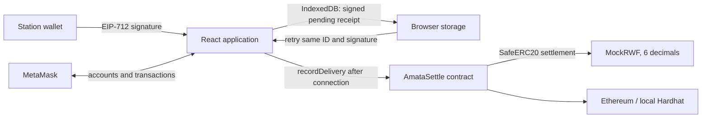

# AmataSettle: An Offline-Ready Blockchain-Based Micro-Settlement Infrastructure for Rwanda's Dairy Supply Chain

**Academic project report**  
**Application areas:** Finance, Supply Chain Management, Social Impact  
**Blockchain:** Ethereum (Sepolia deployment scripts; local Hardhat tests)  
**Status:** Prototype implemented; deployed to Ethereum Sepolia on November 23, 2026; local Hardhat tests pass
**Mission:** To use software engineering to develop secure, accessible and reliable financial and payment systems that expand digital-finance access for underserved Rwandan communities and businesses, particularly in environments constrained by connectivity, digital literacy and financial infrastructure.

> **Evidence notice:** AmataSettle has been deployed to Ethereum Sepolia (chain ID 11155111) on November 23, 2026. The deployed contracts and their deployment transactions are recorded in `deployments/sepolia.json`:
>
> - AmataSettle: [`0x21ffE6b376cF3BCBae2326e12967d40BA3a5d9B6`](https://sepolia.etherscan.io/address/0x21ffE6b376cF3BCBae2326e12967d40BA3a5d9B6)
> - MockRWF: [`0x96db7708B29Ff274DA4672B10a2C1D873E8e2a8f`](https://sepolia.etherscan.io/address/0x96db7708B29Ff274DA4672B10a2C1D873E8e2a8f)
> - MockRWF deployment transaction: [`0x6cec7761b36de64fef9153807eeb0d4cb1b97e730ad4eeec0956a90f198ce6a5`](https://sepolia.etherscan.io/tx/0x6cec7761b36de64fef9153807eeb0d4cb1b97e730ad4eeec0956a90f198ce6a5)
> - AmataSettle deployment transaction: [`0x82f92708bdd0138e3de02eb441aeaa119ca31da24493a24eeef408c0202d045f`](https://sepolia.etherscan.io/tx/0x82f92708bdd0138e3de02eb441aeaa119ca31da24493a24eeef408c0202d045f)
>
> Contract source verification on Etherscan has not been independently confirmed and is not claimed here. Testnet addresses and deployment transaction hashes are taken from `deployments/sepolia.json`; they have not been fabricated. Real-world impact statistics remain unverified; demonstration screenshots are available in `screenshots/`.

## Abstract

Smallholder dairy farmers and cooperatives need clear, verifiable delivery and settlement records. This project implements AmataSettle, an Ethereum prototype that binds a milk-delivery receipt to an authorized collection-station signature using EIP-712, verifies the receipt in a Solidity contract, and reserves simulated token funds for a farmer payment. Farmers can claim an undisputed allocation or raise a dispute within a configurable period. A station web client can sign and save receipts in browser IndexedDB while connectivity is unavailable, then retry the original signed data when connectivity returns. The implementation includes a six-decimal admin-mintable test ERC-20, treasury accounting, role separation, a React/MetaMask interface, local Hardhat tests, and Sepolia deployment scripts. The test suite passed locally (38 Hardhat tests), and the frontend production build succeeded. AmataSettle has been deployed to Ethereum Sepolia; contract addresses and deployment transaction hashes are recorded in `deployments/sepolia.json`. Demonstration screenshots are available in `screenshots/`.

## 1. Introduction and background

Milk collection typically requires a series of operational records: which farmer supplied milk, when the delivery occurred, what quantity was accepted, what quality grade was assigned, what price applied, and whether payment has been completed. This prototype addresses the possibility of disputes and delayed reconciliation by creating a shared, verifiable record of the settlement obligation.

The project is motivated by the stated mission to create secure and accessible financial systems for underserved Rwandan communities and businesses. Connectivity limitations are treated as an engineering constraint for receipt capture, not as a claim about every collection center or cooperative. The design prioritizes a verifiable record, a clear payment formula, and transparent account states.

## 2. Problem identification and justification

**Target problem:** A farmer and cooperative may lack a shared, independently verifiable settlement record linking a specific milk delivery to its quantity, quality, price, calculated value, and payment status. Disagreement or delayed synchronization can make it difficult to reconcile a record created at a collection center.

This project does not assert prevalence or quantify the problem. It tests a prototype response: authorized station keys sign typed receipts; the blockchain verifies their integrity and records the payment obligation; reserved treasury funds cannot be withdrawn as unallocated funds; and a farmer can claim or dispute an allocation.

### Objectives

1. Implement station authorization and EIP-712 receipt verification.
2. Keep cooperative funds and outstanding settlement liabilities internally consistent.
3. Give farmers claim and dispute workflows and designated resolvers an explicit decision.
4. Persist signed receipts locally and synchronize the original data after reconnecting.
5. validate the contract locally and provide repeatable testnet instructions.

## 3. Mission alignment

AmataSettle advances the mission through transparent payment records, cryptographically verifiable obligations, secure transaction processing, and an offline-ready capture workflow. The wallet-based interface is designed to expose relevant state to farmers, stations, and cooperatives without putting private keys in application code. It reduces dependence on a single mutable off-chain transaction record, but does not remove reliance on station key custody, administrators, dispute resolvers, token funding, or physical measurement processes.

## 4. Proposed solution and blockchain justification

The contract stores receipt data, settlement state, reserved liabilities, and relevant events. A separate MockRWF contract represents test balances. Ethereum is used so that participants can independently verify contract state and transaction history. The prototype is not a permissionless retail payment system: roles gate who may submit station data and resolve disputes.

Blockchain is appropriate only if parties value independently verifiable shared settlement records. A conventional database may be cheaper, faster, more private, and easier to correct. The project does not claim blockchain alone guarantees honest measurement, identity, or fair dispute outcomes.

## 5. System architecture

The frontend is an untrusted client: the contract checks access control, signature, deadline, uniqueness, input ranges, treasury availability, and state transitions. Browser IndexedDB is device-local and is not an authoritative or replicated database.

### Transaction flow

1. Station enters delivery fields and MetaMask signs a typed receipt.
2. The browser stores the original data, ID, and signature in IndexedDB as pending.
3. When online, the authorized station submits the exact signed receipt.
4. The contract verifies domain-separated data and role, calculates the amount, and reserves funds.
5. The farmer claims the eligible allocation or raises a dispute.
6. A resolver upholds the allocation or rejects it and releases the reserve.

## 6. Smart contract design

### MockRWF

`MockRWF.sol` is an OpenZeppelin ERC-20 named Mock Rwandan Franc (`mRWF`) with six decimals. Only `MINTER_ROLE` may mint; the deployer begins as admin and minter. The token is not backed by or redeemable for Rwandan francs.

### AmataSettle

`AmataSettle.sol` combines `AccessControl`, OpenZeppelin EIP-712/ECDSA, `SafeERC20`, `Math.mulDiv`, and `ReentrancyGuard`.

| Role | Authority |
|---|---|
| Default administrator | Authorize/revoke station and resolver roles; withdraw only available treasury funds |
| Collection station | Submit a receipt signed by its own authorized key |
| Dispute resolver | Uphold or reject a disputed settlement |
| Farmer | Claim their own allocation or dispute it within the configured period |

Receipt fields are a bytes32 ID, farmer address, quantity in millilitres, whole simulated RWF/litre price, grade 1–5, delivery time, and signature deadline. The typed-data domain is `AmataSettle`, version `1`, the active chain ID, and the settlement contract address.

### Payment arithmetic

All contract arithmetic is integer-only:

`wholeRwf = floor(quantityMilliLitres × pricePerLitre / 1000)`  
`tokenBaseUnits = wholeRwf × 1,000,000`

For 15,000 mL at 500 RWF/litre: `15,000 × 500 / 1,000 = 7,500 RWF`, represented by `7,500,000,000` six-decimal token units. A result rounding to zero is rejected.

### Treasury invariant and lifecycle

The available amount is computed from the actual ERC-20 balance:

`available = tokenBalance − reservedFunds`

Recording allocates and reserves the obligation. Claiming transfers the payment and lowers the reserve by the same amount. Raising a dispute makes the allocation unclaimable but leaves its reserve locked. Upholding restores claimability; rejecting the payment reduces the reserve without transferring tokens. Admin withdrawals cannot exceed available funds.

States are `None → Allocated → Claimed`, or `Allocated → Disputed → Allocated` when upheld, or `Allocated → Disputed → Rejected` when rejected.

## 7. Offline-first workflow

When a station signs, the browser persists the delivery ID, typed data, signature, creation time, status, and later transaction hash in IndexedDB. A retry reuses the saved identifier and signature. The interface does not call a receipt synchronized until a transaction is confirmed; failures remain visible and retryable. If that delivery ID is already recorded on-chain, the queue avoids sending a duplicate.

Offline is not a guarantee of persistence: browser storage can be cleared or lost. EIP-712 proves that a key signed data; it does not prove that the physical quantity or quality was measured correctly. Production operation would require key backup/rotation, device recovery, a shared operational queue, and clear receipt-dispute procedures.

## 8. Frontend implementation

The React/TypeScript/Vite application provides a landing view and role-aware farmer, station, cooperative, and resolver controls. It uses ethers v6 with MetaMask, checks Sepolia chain ID, reads contract state, waits for transaction confirmations, and exposes transaction hashes. Station receipt signing and local queue persistence are separated into contract ABI/service and IndexedDB modules. All displayed balances are read from configured contracts; there are no mock dashboard records.

## 9. Security considerations

Controls implemented include role checks, EIP-712 domain separation, ECDSA recovery, station-caller and recovered-signer equality, unique IDs, signature deadlines, validation of delivery attributes, SafeERC20, guarded token-moving functions, one-time state transitions, liability-aware withdrawal caps, and an emergency pause mechanism.

The contract inherits OpenZeppelin `Pausable`. Only an account with `DEFAULT_ADMIN_ROLE` may call `pause()` or `unpause()`. While paused, deposits, withdrawals, delivery recording, and farmer payment claims are blocked. Dispute creation, dispute resolution, and role management remain available. The paused state is read directly from the deployed contract via the `paused()` view function, and the administrator frontend provides Pause Contract and Resume Contract buttons.

Remaining trust and risk include compromised station keys, dishonest measurement, administrator/resolver governance, public disclosure of contract data, local browser storage loss, unsupported token behavior, and the absence of an independent audit. Dispute reasons are on-chain and should not include personal or sensitive information. The demo token must never be represented as a stablecoin or real currency.

## 10. Implementation and deployment

The repository includes Hardhat 3 configuration, Solidity 0.8.28 contracts, local tests, a local demonstration script, Sepolia deployment/setup scripts, and Vite frontend configuration. The deployer must provide a Sepolia RPC URL and private key locally in an ignored `.env`; the browser uses MetaMask and never accepts pasted private keys.

**Deployment status:** Deployed to Ethereum Sepolia on November 23, 2026.

| Item | Value |
|------|-------|
| Network | Ethereum Sepolia (chain ID 11155111) |
| Deployer | `0x55D23cA45Eace7E4497C780f89eac62f61421B3E` |
| AmataSettle | [`0x21ffE6b376cF3BCBae2326e12967d40BA3a5d9B6`](https://sepolia.etherscan.io/address/0x21ffE6b376cF3BCBae2326e12967d40BA3a5d9B6) |
| MockRWF | [`0x96db7708B29Ff274DA4672B10a2C1D873E8e2a8f`](https://sepolia.etherscan.io/address/0x96db7708B29Ff274DA4672B10a2C1D873E8e2a8f) |
| Dispute period | 604,800 seconds (7 days) |
| MockRWF deployment tx | [`0x6cec7761b36de64fef9153807eeb0d4cb1b97e730ad4eeec0956a90f198ce6a5`](https://sepolia.etherscan.io/tx/0x6cec7761b36de64fef9153807eeb0d4cb1b97e730ad4eeec0956a90f198ce6a5) |
| AmataSettle deployment tx | [`0x82f92708bdd0138e3de02eb441aeaa119ca31da24493a24eeef408c0202d045f`](https://sepolia.etherscan.io/tx/0x82f92708bdd0138e3de02eb441aeaa119ca31da24493a24eeef408c0202d045f) |

Contract addresses and hashes are taken from `deployments/sepolia.json`. Contract source verification on Etherscan has not been independently confirmed and is not claimed here.

The deployer must provide a Sepolia RPC URL and private key locally in an ignored `.env`; the browser uses MetaMask and never accepts pasted private keys.

See [docs/DEPLOYMENT.md](./docs/DEPLOYMENT.md) for precise setup and commands.

See [docs/DEPLOYMENT.md](./docs/DEPLOYMENT.md) for precise setup and commands.

## 11. Test methodology and actual results

Contract tests run against Hardhat's local network and use local accounts to sign EIP-712 data. Coverage includes deployment, roles, treasury invariants, valid and invalid signatures, replay, input validation, offline-delayed submission, claims, disputes, events, and accounting through multiple transitions.

**Actual result:** 38 Hardhat tests passed. `npm run build:web` also completed TypeScript project checks and a Vite production build. These checks do not prove a Sepolia deployment or a browser MetaMask integration. See [docs/TESTING.md](./docs/TESTING.md) for each case and its result.

## 12. Limitations and future work

This is not a production payment service. It has no production identity system, oracle for milk measurements, privacy layer, external stablecoin, key custody service, indexed analytics backend, multisig governance, independent audit, or mobile device recovery. A local queue belongs to one browser profile. Testnet availability and token balances are not real-world liquidity.

Future work could evaluate a permissioned network or conventional signed database, multisignature administration, measurement-device integration, privacy-preserving farmer identifiers, resilient queue backups, better local-language UX, independent security review, usability studies, and a production legal/governance model.

## 13. Conclusion

AmataSettle demonstrates a bounded way to connect station-signed delivery records with reserved farmer settlement obligations and disputes. It treats offline capture, accounting correctness, and role-based trust as essential design concerns. The local tests and frontend build succeeded, while Sepolia deployment remains an explicit student task. The result is a technically testable prototype aligned with a mission of more transparent and accessible financial processes, not evidence that the broader social or operational problem has already been solved.

## References

1. Buterin, V., et al. **EIP-712: Typed structured data hashing and signing.** https://eips.ethereum.org/EIPS/eip-712
2. Ethereum Foundation. **Ethereum developer documentation: Sepolia test network.** https://ethereum.org/en/developers/docs/networks/#sepolia
3. OpenZeppelin. **Contracts documentation: Access Control, ERC-20, and security utilities.** https://docs.openzeppelin.com/contracts/
4. Solidity documentation. **Solidity language and security considerations.** https://docs.soliditylang.org/
5. Mozilla Developer Network. **IndexedDB API.** https://developer.mozilla.org/en-US/docs/Web/API/IndexedDB_API

## Appendix A: Evidence

- Sepolia contract addresses: [`0x21ffE6b376cF3BCBae2326e12967d40BA3a5d9B6`](https://sepolia.etherscan.io/address/0x21ffE6b376cF3BCBae2326e12967d40BA3a5d9B6) (AmataSettle) and [`0x96db7708B29Ff274DA4672B10a2C1D873E8e2a8f`](https://sepolia.etherscan.io/address/0x96db7708B29Ff274DA4672B10a2C1D873E8e2a8f) (MockRWF), recorded in `deployments/sepolia.json`.
- Sepolia deployment transaction hashes: [`0x6cec7761b36de64fef9153807eeb0d4cb1b97e730ad4eeec0956a90f198ce6a5`](https://sepolia.etherscan.io/tx/0x6cec7761b36de64fef9153807eeb0d4cb1b97e730ad4eeec0956a90f198ce6a5) (MockRWF) and [`0x82f92708bdd0138e3de02eb441aeaa119ca31da24493a24eeef408c0202d045f`](https://sepolia.etherscan.io/tx/0x82f92708bdd0138e3de02eb441aeaa119ca31da24493a24eeef408c0202d045f) (AmataSettle).
- Deployment/dashboard screenshots: `screenshots/01-sepolia-deployment.png`, `screenshots/02-treasury-dashboard.png`, `screenshots/03-farmer-payments.png`, `screenshots/04-emergency-pause.png`, `screenshots/05-tests-passing.png`, and `screenshots/contract.png`.
- Local test output: **38 passing** (see `npm test`)
- Local end-to-end output: generated by `npm run demo:local`; clearly label as Hardhat local
- `REPORT.pdf`: generated in repository root.
- `AmataSettle_Presentation.pptx`: generated in repository root.

Do not claim screenshots exist unless the files are present in the repository.
