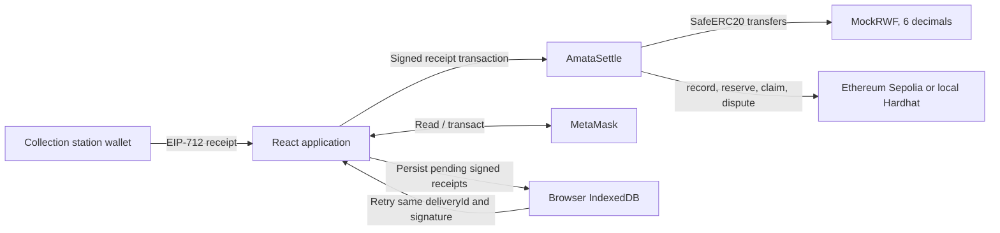

# AmataSettle architecture

## Purpose and mission

AmataSettle is a prototype for transparent settlement of milk deliveries between smallholder farmers and dairy cooperatives in Rwanda. Its mission alignment is to use secure, accessible software to improve the verifiability of financial obligations in communities and businesses where connectivity and financial infrastructure may be constrained. These are design goals, not claims that all cooperatives share the same problems.

## Components



The browser is an untrusted client. Solidity enforces authorization, signature validity, accounting, and state transitions. IndexedDB stores an offline queue only on the current browser/device; it is not a shared database or proof of on-chain recording.

## Signed receipt and settlement flow

```mermaid
sequenceDiagram
  participant S as Authorized station
  participant B as Browser / IndexedDB
  participant C as AmataSettle
  participant F as Farmer
  S->>B: Enter delivery and sign EIP-712 data
  B->>B: Save immutable receipt and pending status
  B->>C: Submit the same receipt when online
  C->>C: Check signer, deadline, uniqueness, input, and treasury
  C->>C: Reserve payment and record allocation
  F->>C: Claim, or raise a dispute
  C->>F: Transfer on claim; disputed reserve stays locked
```

## Accounting and units

Quantity is integer millilitres; price is whole simulated RWF per litre. The contract computes `floor(quantityMilliLitres × pricePerLitre / 1000)` whole RWF, then scales that amount by `10^6` for the six-decimal MockRWF token. Thus 15,000 mL at 500 RWF/L allocates 7,500,000,000 base units (7,500 simulated RWF).

At all times:

`available = ERC-20 balance held by AmataSettle − reservedFunds`

Recording a receipt increases the reserve; claiming transfers tokens and decreases both balance and reserve by the same amount; rejecting a dispute decreases only the reserve. Withdrawals are capped at available funds.

## Trust and limits

An EIP-712 signature authenticates the station key's approval of a receipt and prevents data alteration across chains/contracts. It does not prove that the physical milk quantity, quality, or price is true. Offline receipts remain dependent on station key security and the local browser's availability. Production use requires governance, key custody, privacy review, audited measurement processes, monitoring, and a resilient backup/synchronization strategy.
